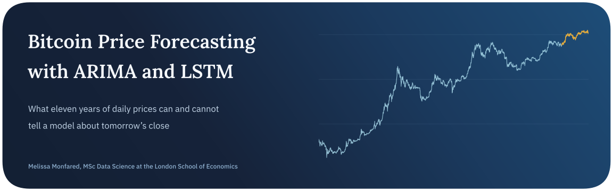
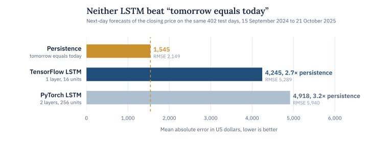
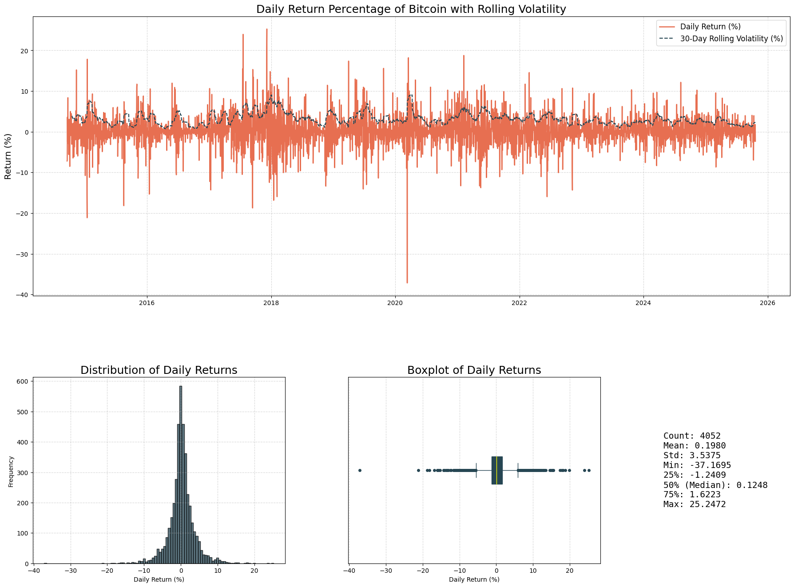
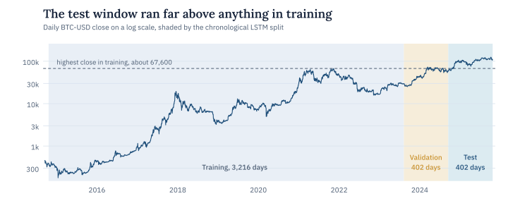
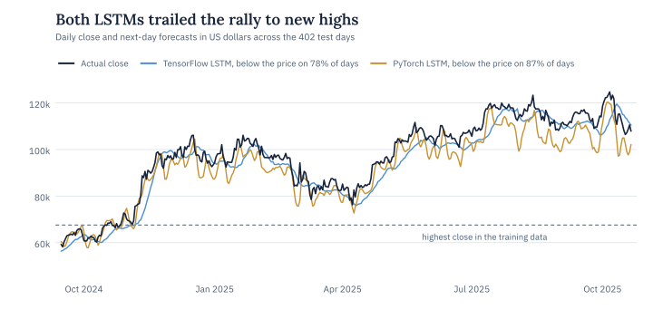
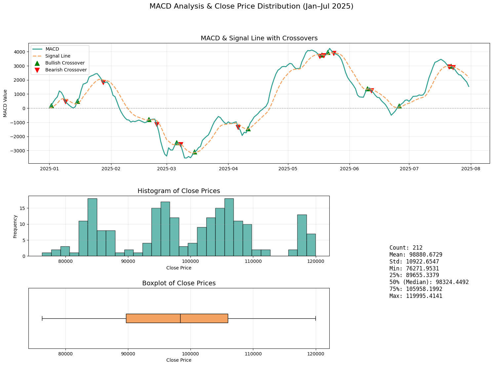

<p align="center">
  
</p>

<p align="center">
  <a href="https://www.kaggle.com/code/melissamonfared/bitcoin-price-forecasting-arima-lstm"></a>
  
  
  
</p>

Bitcoin trades every day of the year and moves a lot, with single-day returns that ranged from a 37% fall to a 25% rise over the last decade. This project asks a plain question about that series. Given everything up to today, how well can a model predict tomorrow’s closing price?

I pulled eleven years of daily BTC-USD prices from Yahoo Finance and built a set of technical indicators on top of them. On that data I trained two LSTM networks, one in TensorFlow and one in PyTorch, next to a classical ARIMAX model, and held the networks to the simplest forecast there is, that tomorrow’s close will equal today’s.

> **In short.** Neither LSTM beat that naive forecast. On the 402 test days, carrying yesterday’s close forward was off by 1,545 dollars on average, while the TensorFlow and PyTorch networks were off by 4,245 and 4,918. Both called the direction of the next move about as well as a coin, and both trailed a rally that took the price far above anything they had trained on.

## Key findings

| Finding | Evidence |
| :-- | :-- |
| Tomorrow equals today was the forecast to beat | Carrying the last close forward missed by 1,545 on average across the 402 test days. The TensorFlow LSTM missed by 4,245 and the PyTorch LSTM by 4,918 |
| Neither network could call the direction | Measured against the previous day’s close, the TensorFlow LSTM got the direction of the move right on 50.0% of days and the PyTorch LSTM on 48.3% |
| The smaller network learned a moving average | The TensorFlow LSTM’s forecasts sit closest to the price from seven days earlier, so it follows trends smoothly but about a week late |
| Both networks undershot the rally | The TensorFlow model forecast below the actual close on 78% of test days and the PyTorch model on 87%, while the price moved between about 58,000 and 125,000 |
| The test period sat outside the training range | The highest close in the training data was about 67,600, so most test-day prices were new territory for both models |
| Bitcoin’s daily moves are large and fat-tailed | Daily returns have a standard deviation of 3.54% and ranged from −37.2% on 12 March 2020 to +25.2% on 7 December 2017, with 97.5% of days inside ±10% |

<picture>
  <source media="(prefers-color-scheme: dark)" srcset="assets/results-dark.svg">
  
</picture>

## Conclusion

At a one-day horizon, Bitcoin’s price behaves a lot like a random walk. The best single guess for tomorrow is today’s close, and neither network found a pattern in the previous nineteen days of prices and indicators that improves on it. That is roughly what you would expect in a liquid market where yesterday’s information is already in today’s price.

The networks also ran into a problem that has nothing to do with their architecture. They were trained on price levels, and the test period pushed far past the highest price in training, so both had to extrapolate. The small TensorFlow model handled that by smoothing, which made its forecasts look realistic on a chart while staying about a week behind. The much larger PyTorch model reacted faster but forecast below the price on 87% of days.

Predicting returns instead of price levels would remove the extrapolation problem, and keeping persistence in every comparison shows straight away whether a model adds anything at all.

## The data

Daily open, high, low, close and volume for BTC-USD come from Yahoo Finance through the yfinance library. The series runs from 17 September 2014, the first day Yahoo has, to 21 October 2025, the day the notebook last ran. That gives 4,053 days with no gaps or missing values, since Bitcoin trades every day.

On top of the prices I built the usual technical indicators, daily returns with a 30-day rolling volatility, simple and exponential moving averages over 3 to 50 days, MACD with its signal line, a 14-day RSI with Wilder’s smoothing and Bollinger bands over 15 days at two standard deviations.



*Daily returns with their 30-day rolling volatility. Most days stay within ±10%, with rare shocks like the 37% fall in March 2020.*

Both LSTMs use the same chronological split of 4,020 windows, each made of nineteen days of features followed by the day to predict.

| Split | Days | Dates |
| :-- | --: | :-- |
| Training | 3,216 | 20 Oct 2014 to 9 Aug 2023 |
| Validation | 402 | 10 Aug 2023 to 14 Sep 2024 |
| Test | 402 | 15 Sep 2024 to 21 Oct 2025 |

<picture>
  <source media="(prefers-color-scheme: dark)" srcset="assets/timeline-dark.svg">
  
</picture>

The ARIMAX model uses its own 80/20 split, training up to 5 August 2023 and testing on the 808 days after it.

## The models

| Model | Inputs | Set-up |
| :-- | :-- | :-- |
| ARIMAX(1,1,1) | Closing price with eight indicators as exogenous regressors | statsmodels SARIMAX, with one difference chosen by an ADF test (p = 0.95 on prices, p < 0.001 after differencing) |
| TensorFlow LSTM | Nineteen days of 14 price and indicator features | One LSTM layer of 16 units, dropout 0.5 and two dense layers, 3,515 trainable parameters, early stopping on validation loss |
| PyTorch LSTM | The same windows and features | Two stacked LSTM layers of 256 units with dropout 0.3, Adam, learning-rate halving and early stopping on validation loss |

Both networks predict the next day’s close, and their test errors are measured in dollars after undoing the scaling.

<picture>
  <source media="(prefers-color-scheme: dark)" srcset="assets/forecasts-dark.svg">
  
</picture>

<details>
<summary><b>Technical indicators in action</b></summary>
<br>


MACD against its signal line from January to July 2025, with crossovers marked. The notebook gives every other indicator the same treatment.

</details>

## Limitations and next steps

The ARIMAX model is given same-day indicators, such as the 7-day EMA and the daily return, that are computed from the very closing price it is trying to predict. Its test error therefore doesn’t measure a real forecast, so I’m re-running it with every indicator lagged by one day and will add the result here.

The LSTM scalers are fitted on the whole series rather than on the training days alone, which lets the test period’s price range leak into training. Every model is also judged on a single chronological split.

Next I want to model daily log returns instead of price levels and evaluate with a walk-forward scheme that refits as new days arrive. Persistence stays in every comparison from here on.

## Running it

The quickest way is to [open the notebook on Kaggle](https://www.kaggle.com/code/melissamonfared/bitcoin-price-forecasting-arima-lstm). The data downloads itself through yfinance, so there are no files to fetch. To run it locally, install the packages below and start the notebook. Its first cell installs the extra packages it uses.

```bash
pip install yfinance pandas numpy matplotlib seaborn plotly mplfinance statsmodels scikit-learn tensorflow torch
jupyter notebook bitcoin-price-forecasting-arima-lstm.ipynb
```

Because the notebook pulls prices up to the day it runs, your numbers will differ slightly from the ones here, which come from the run on 21 October 2025.

## Repository

```text
.
├── bitcoin-price-forecasting-arima-lstm.ipynb   data, indicators, ARIMAX and both LSTMs
├── assets/                                      figures used in this README
└── README.md
```

## About

Made by Melissa Monfared, MSc Data Science at the London School of Economics. More projects live on [my website](https://melissamonfared.github.io). I also post notebooks on [Kaggle](https://kaggle.com/melissamonfared) and I’m on [LinkedIn](https://linkedin.com/in/melissamonfared).

Price data from Yahoo Finance through the yfinance library.
